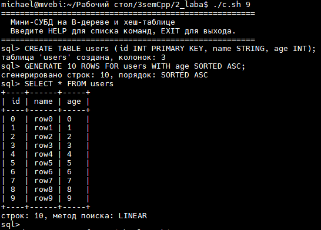
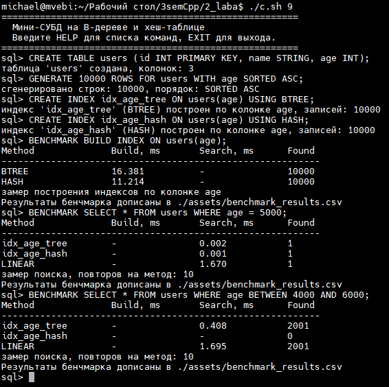

# Мини-СУБД на C++ (Лабораторная работа №2)

Репозиторий содержит реализацию лабораторной работы №2 по курсу «Программирование на C++» в НИЯУ МИФИ. Проект представляет собой консольную мини-систему управления базами данных с поддержкой индексации, SQL-подобного синтаксиса, планировщика запросов и встроенного бенчмаркинга.

## Основные возможности

- **Слой данных**: Хранение таблиц со строгой схемой (INT, DOUBLE, STRING). Использование механизма **Tombstones** для удаления строк, что гарантирует стабильность идентификаторов `row_id` и целостность индексов.
- **Индексация**: 
  - **B-дерево (2-3 дерево)**: Поддерживает точечный поиск и диапазоны (`BETWEEN`, `>`, `<`) за $O(\log N + R)$.
  - **Хеш-таблица**: Реализована с разрешением коллизий методом цепочек. Поддерживает только точечный поиск за $O(1)$.
- **SQL-парсер**: Рекурсивный спуск с лексическим анализатором. Выдаёт человеко-читаемые ошибки с указанием позиции символа.
- **Планировщик запросов**: Автоматически выбирает оптимальный метод доступа (HASH для `=`, BTREE для диапазонов, LINEAR как fallback). Поддерживает принудительный выбор индекса через `WITH INDEX`.
- **Сериализация**: Сохранение и загрузка таблиц в бинарный формат (`.db`) с валидацией магических чисел и версий. При загрузке индексы перестраиваются автоматически.
- **Бенчмаркинг**: Встроенные команды `BENCHMARK BUILD` и `BENCHMARK SELECT` с автоматическим экспортом результатов в `assets/benchmark_results.csv` для построения графиков.

## Демонстрация работы

### 1. Интерактивный режим (REPL)
Создание таблицы, индексация, вставка данных и форматированный вывод результатов запроса.



### 2. Бенчмаркинг и сравнение алгоритмов
Сравнение времени построения и поиска для B-дерева, хеш-таблицы и линейного просмотра. Результаты автоматически сохраняются в CSV.



## Сборка и запуск

### Требования
- Компилятор с поддержкой **C++20** (GCC 11+ или Clang 13+)
- ОС: Linux / macOS / WSL

### Скрипт управления (`c.sh`)
Проект использует удобный bash-скрипт для компиляции и запуска тестов:

```bash
# Сделать скрипт исполняемым (при первом запуске)
chmod +x c.sh

# Запустить все модульные и интеграционные тесты
./c.sh all

# Запустить интерактивный режим (REPL)
./c.sh 9
```

## Пример использования

```sql
-- 1. Создание таблицы с первичным ключом
CREATE TABLE users (id INT PRIMARY KEY, name STRING, age INT);

-- 2. Создание индексов
CREATE INDEX idx_age_tree ON users(age) USING BTREE;
CREATE INDEX idx_name_hash ON users(name) USING HASH;

-- 3. Вставка данных
INSERT INTO users VALUES (1, 'Alice', 25);
INSERT INTO users VALUES (2, 'Bob', 30);

-- 4. Выполнение запросов
SELECT * FROM users WHERE age BETWEEN 20 AND 28;
SELECT name FROM users WITH INDEX(idx_name_hash) WHERE name = 'Alice';

-- 5. Бенчмарк поиска
BENCHMARK SELECT * FROM users WHERE age = 25;

-- 6. Сохранение в файл
SAVE users TO 'users_backup.db';
```

## Структура проекта

```text
.
├── cli/                # Точка входа: интерактивный REPL (main.cpp)
├── core/               # Ядро СУБД:
│   ├── Database.h      # Реестр таблиц
│   ├── Table.h         # Логика таблиц, tombstones, планировщик
│   ├── Index.h         # Абстракция IIndex, BTreeIndex, HashIndex
│   ├── SQLParser.h     # Лексер и парсер рекурсивным спуском
│   ├── QueryExecutor.h # Исполнитель AST-запросов
│   └── Serializer.h    # Бинарная сериализация/десериализация
├── lib/                # Базовые контейнеры (DynamicArray, HashTable)
├── tests/              # Модульные и интеграционные тесты (Catch-like макросы)
├── assets/             # Демонстрационные SQL-скрипты и результаты бенчмарков
└── c.sh                # Скрипт для сборки и запуска тестов
```

## Авторы

- **Великанов М.Н.**
- Группа: Б25-507
- Учебное заведение: НИЯУ МИФИ
- Год: 2026

---
*Проект разработан в учебных целях в рамках курса «Информатика (Нелинейные сттруктуры)».*
